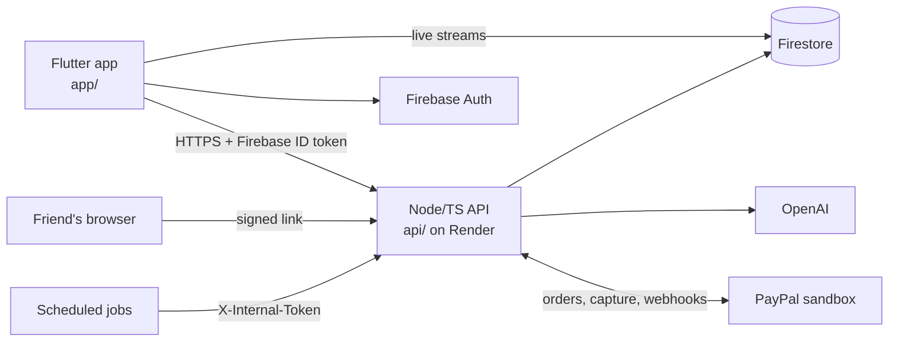

<p align="center">
  
</p>

<h1 align="center">Split</h1>

<p align="center">Snap the bill. Everyone pays their bit.</p>

After a group meal, one person pays the whole bill. Working out who had what means squinting at the receipt and arguing about the service charge. Then that person spends days chasing everyone for their share.

Split reads the receipt, lets each friend say in plain words what they had, works out every share to the penny, and sends each friend a PayPal link that pays the organiser directly. Friends never install anything. Their link opens a web page.

Split is the sister app to [Sorted](https://github.com/tade-dev/sorted). It reuses Sorted's design system, motion layer, API shell, AI layer and PayPal pipeline. [docs/reused-from-sorted.md](docs/reused-from-sorted.md) lists every file that came from it.

## Try it

- **Web:** https://split-b66c0.web.app. You are signed in straight away as **Kemi**, an organiser.
- **API health:** https://split-api-k5ai.onrender.com/v1/health
- **Demo video:** DEMO_VIDEO_TBD

You can play every part on your own:

1. Tap **Try a sample bill**. Split reads the Little Bao House receipt and checks it adds up to £154.69.
2. Add a few friends, then tap **Ask everyone what they had**.
3. On the claims screen, type what each friend had, for example "Dan had the bao buns and a Tsingtao". Friends do the same from their own links.
4. Tap **Totals**, then **Send links**.
5. On the tracker, open Dan's row menu, pick **Preview as Dan**, and pay with the sandbox buyer below. Dan's row flips to **Paid** without a reload.

From the tracker you can also **Nudge** a friend, **Mark as paid in cash**, or **Cancel** the split. Tap your avatar on Home to set the name friends see and your PayPal email.

### PayPal sandbox

No real money moves. Pay as this sandbox buyer:

| | |
|---|---|
| Email | `TODO: sandbox buyer email` |
| Password | `TODO: sandbox buyer password` |

With no PayPal email set in Settings, payments go to Split's sandbox merchant. Set a sandbox **personal** account email there and the money lands in that account instead ([verified](docs/verified-facts.md)).

## How it uses AI and PayPal

**AI**

The model reads; code counts.

- **Receipt read.** One or two photos of the bill go to the vision model (`POST /v1/splits/scan`). It returns the lines, the service charge and the printed total. Code then checks that the lines add up to that total. A bill that doesn't add up can't be sent.
- **Plain-words claims.** "I had the ramen and half the gyoza" becomes claims on lines (`POST /v1/s/.../claim`). A friend can only claim for themselves, and sees a preview to confirm before anything is saved. The organiser can claim for anyone from the claims chat (`POST /v1/splits/:id/claims/message`).
- **Rules in words.** "It's Sam's birthday so his is on us" becomes a rule (`POST /v1/splits/:id/rules/message`). It always shows as a confirm card with the figure first.
- **Nudges.** A friend who still owes is due a reminder at 24 hours and again at 72 hours, at most twice. The organiser picks a tone (friendly, cheeky or firm), and the AI drafts a reminder under 40 words with the friend's own link in it exactly once. If a draft fails that check, a plain template is used instead. Split never messages anyone itself.
- **Every amount comes from code.** `api/src/domain/allocate.ts` uses largest remainder, with a golden fixture and property tests, so the shares always add up to the bill.

**PayPal (sandbox)**

- **Pay the organiser.** A friend's Pay button creates a PayPal checkout order (Orders v2). The organiser is the payee, through `payee.email_address`, so the money goes straight to them.
- **Capture on return.** When the friend comes back from PayPal, the API captures the payment and sends them to their page, which now reads Paid.
- **Webhooks.** `POST /v1/webhooks/paypal` verifies each event with PayPal and applies approved, completed, pending, denied and refunded events.
- **Reconcile.** A scheduled job re-checks open orders with PayPal, so a missed return and webhook are picked up within about 10 minutes.
- **Unlock, cancel and expiry.** Unlocking a split or cancelling it retires any open PayPal order. Unpaid orders are replaced after `ORDER_EXPIRY_HOURS` (default 168, seven days). A capture that lands on a retired order is marked as needing a refund.

## Architecture



[docs/architecture.md](docs/architecture.md) walks through one bill end to end, the share lifecycle and the data model.

| Path | What it is |
|---|---|
| `app/` | Flutter app for the organiser (web, iOS, Android) |
| `api/` | Node + TypeScript (Express) API and the friend pages, deployed on Render via `api/render.yaml` |
| `samples/` | The demo bill (`demo-split.json`) and four sample receipts |
| `docs/` | Design spec, screens, plans, architecture and verified facts |
| `firestore.rules` | Firebase security rules |
| `scripts/emulators.sh` | Starts the Firestore and Auth emulators for tests |

## Running locally

### API

Needs Node 18+.

```sh
cd api
npm ci
npm run dev        # tsx watch, listens on PORT (default 3000)
```

`npm run build && npm start` runs the compiled build. Health check: `GET /v1/health`.

Environment variables come from `api/render.yaml`. Set them in your shell or a `.env` file, and never commit values:

| Variable | What it's for |
|---|---|
| `NODE_ENV` | `development`, `test` or `production` |
| `PAYPAL_CLIENT_ID` | PayPal REST app client id |
| `PAYPAL_CLIENT_SECRET` | PayPal REST app secret |
| `PAYPAL_WEBHOOK_ID` | Id of the PayPal webhook, used to verify incoming events |
| `OPENAI_API_KEY` | Key for the AI calls (receipt, claims, rules, nudges) |
| `OPENAI_VISION_MODEL` | Model used for those calls |
| `FIREBASE_PROJECT_ID` | Firebase project the API reads and writes |
| `FIREBASE_SERVICE_ACCOUNT_JSON` | Service-account JSON, on one line, for Firestore admin access |
| `INTERNAL_TOKEN` | Shared secret for the internal workflow endpoints |
| `LINK_SECRET` | Signs friends' links. Must differ from `INTERNAL_TOKEN` |
| `PUBLIC_BASE_URL` | Origin for friend links and the PayPal return pages. Defaults to the hosted Render URL |
| `ORDER_EXPIRY_HOURS` | When an unpaid PayPal order is replaced (default 168) |

Optional, not in `render.yaml`: `PORT` (default 3000), and `PAYPAL_ENV` (sandbox unless set to `live`).

### Internal workflow endpoints

Called by scheduled jobs. Each is a `POST` with the header `X-Internal-Token: <INTERNAL_TOKEN>`.

| Endpoint | Schedule | What it does |
|---|---|---|
| `/v1/internal/workflows/reconcile` | Every 10 minutes | Re-checks open orders with PayPal |
| `/v1/internal/workflows/expire-sweep` | Hourly | Replaces unpaid orders past `ORDER_EXPIRY_HOURS` |
| `/v1/internal/workflows/nudge-sweep` | Hourly | Pre-drafts reminders for friends who are due one. It sends nothing |

### App

Needs Flutter and a Firebase project configured for the app.

```sh
cd app
flutter pub get
flutter run -d chrome --dart-define=API_BASE_URL=http://localhost:3000
```

Without `API_BASE_URL` the app talks to the hosted API.

## Tests

API. Needs JDK 21+ and firebase-tools for the emulators:

```sh
cd api
npm run emulators   # in one terminal; runs offline against the demo-split project
npm test            # in another
npm run typecheck
```

`*.live.test.ts` suites call the real model and are skipped unless the credentials are set.

App:

```sh
cd app
flutter test
```

## Licence

MIT. See [LICENSE](LICENSE).
