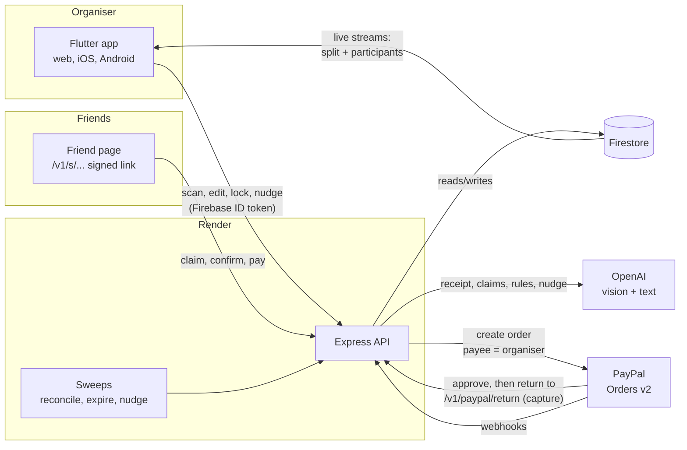

# Architecture

Split has three parts:

- A Flutter app for the organiser: the person who paid the bill.
- A Node + TypeScript API on Render.
- Firestore.

Friends never install anything. Their link opens a server-rendered page on the API.



## One bill, end to end

1. **Scan.** `POST /v1/splits/scan` sends one or two photos to the vision model (`ai/extract_receipt.ts`).
   - The model returns lines, a service charge and a total.
   - Code checks that the lines add up to the printed total (`domain/receipt.ts`). A bill that does not add up cannot be locked.
2. **People and links.** The organiser adds names. `POST /splits/:id/open` signs one link per friend (`domain/links.ts`, HMAC with `LINK_SECRET`) and writes the group message from a template.
3. **Claims.** A friend types "I had the bao and two Tsingtaos" on their page.
   - The model maps the words to lines (`ai/parse_claim.ts`); a friend can only claim for themselves.
   - The friend confirms the preview before anything is saved.
   - The organiser can also claim for anyone from the app's chat view.
4. **Rules.** Service charge mode, shared items and "on us" can be said in words (`ai/parse_rules.ts`). They always show as a confirm card first.
5. **Lock.** Code, not the model, works out every share to the penny (`domain/allocate.ts`): largest remainder, with a golden fixture and property tests. Locking freezes claims, rules and shares.
6. **Pay.** The friend taps Pay.
   - The API creates a PayPal order with `payee.email_address` set to the organiser's PayPal email, or the sandbox merchant if none is set.
   - `custom_id` is `organiser:split:participant`.
7. **Paid.** Three paths land a payment, and whichever comes first wins:
   - The return page captures the order.
   - The webhook arrives.
   - The reconcile sweep finds it.
   `domain/shares.ts` guards every status move, and `settleIfDone` marks the split settled in the same transaction as the last payment. The organiser's tracker streams the participants subcollection, so the row flips to Paid with no reload.

## Share lifecycle

```
invited → claimed → (lock) → owes → link_opened → processing / pending → paid
                                         │   ↑                ↘ declined → (retry)
                                         └───┴── paid_cash (organiser marks it)
organiser and on-us friends: on_us
```

- **Unlock** puts shares back to claiming and supersedes any open PayPal order. It is refused once anyone has paid.
- **Cancel** supersedes open orders and shows friends "This bill was cancelled".
- A capture that lands on a superseded order is flagged `refundDue`. It is never counted.

## Data

```
organisers/{uid}                    displayName, paypalEmail
  splits/{splitId}                  status, receipt, claims, rules, computed, links, lockedAt
    participants/{pid}              name, status, shareMinor, paypalOrderId, supersededPaypalOrderIds, nudge
      paymentEvents/{id}            ledger of every PayPal event and organiser action
```

Firestore rules let an organiser read only their own tree. The app never writes; every change goes through the API.

## Background work

The API exposes three internal endpoints, protected by `INTERNAL_TOKEN`:

- `reconcile`: every 10 minutes from an external cron. It catches approvals whose return and webhook were both missed.
- `expire-sweep`: hourly. It replaces unpaid PayPal orders older than `ORDER_EXPIRY_HOURS`.
- `nudge-sweep`: hourly. It drafts a reminder for friends who still owe after 24h and 72h. The organiser always sends it themselves.

A GitHub Actions workflow (`.github/workflows/sweeps.yml`) calls them as a backup.

## What came from Sorted

The design system, motion layer, API shell, the AI seam (`generateStructured`, strict JSON schema with one corrective retry) and the PayPal pipeline came from [Sorted](https://github.com/tade-dev/sorted). [reused-from-sorted.md](reused-from-sorted.md) lists every file.
